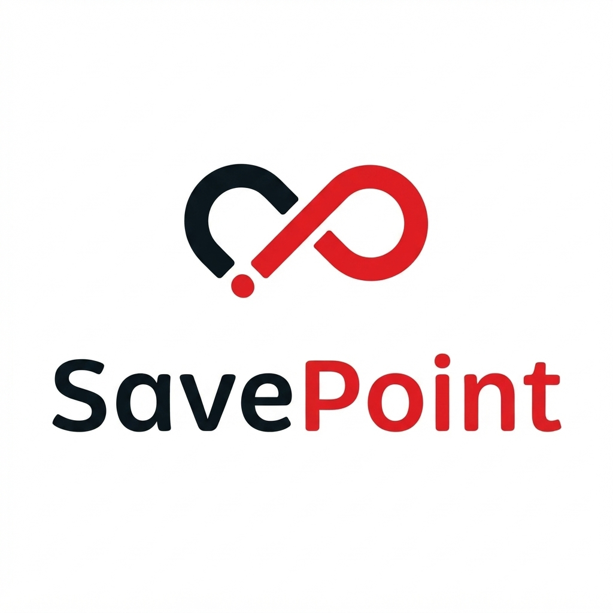
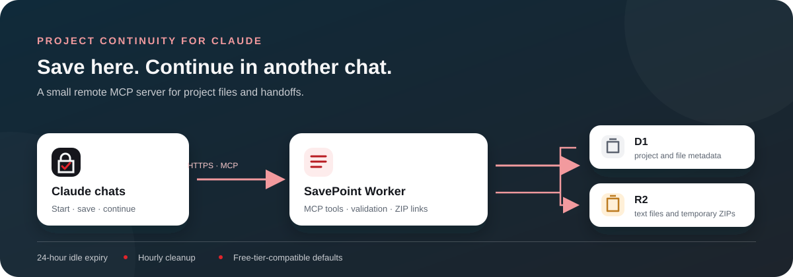

<p align="center">
  
</p>

<p align="center"><strong>Keep project files available across Claude chats.</strong><br />A small remote MCP server backed by Cloudflare Workers, D1, and R2.</p>

<p align="center">
  <a href="https://github.com/mocin84/savepoint-mcp/actions/workflows/validate.yml"></a>
  
  
</p>

SavePoint gives Claude a place to save a text-based project and pick it up in another chat. It returns a short continue box for the next chat, saves file changes made through its MCP tools, and keeps a project handoff note in `NOTES.md`.

> SavePoint is an independent open-source project and is not affiliated with or endorsed by Anthropic or Cloudflare.

## How it works



1. Add the remote MCP connector to Claude and enable it in a chat.
2. Ask Claude to start a project. SavePoint creates a project and returns a continue box.
3. Claude saves files with SavePoint tools. Successful file writes, edits, and deletes are logged to `NOTES.md`.
4. Paste the continue box into another chat with the connector enabled to reopen the project.
5. Ask for a ZIP download when you want a local copy.

Claude must call SavePoint's file tools for changes to be stored. Server instructions encourage it to create the project before work and save each edit right away, but the model controls whether and when it calls tools.

## Features

- One remote MCP connector for creating and continuing projects
- Version-aware file writes and edits to catch conflicting changes
- Automatic `NOTES.md` change entries after successful file operations
- ZIP downloads through short-lived links
- Hourly cleanup of expired project data
- Per-project file, file-count, and total-size limits
- Optional connector-wide access key

## Deploy on Cloudflare

SavePoint is designed for Cloudflare Workers, D1, and R2. The default configuration uses free-tier-compatible settings, but quotas and account usage can change. Check current Cloudflare limits and your account usage before deployment.

### Requirements

- Node.js 20 or newer
- A Cloudflare account with Workers, D1, and R2 available
- A domain is optional; the default deployment uses a `workers.dev` hostname

### Setup

```sh
npm ci
npx wrangler login
npx wrangler d1 create savepoint-db
npx wrangler r2 bucket create savepoint-files
npx wrangler kv namespace create OAUTH_KV
```

Copy the D1 `database_id` and KV namespace `id` from Wrangler's output into `wrangler.toml`, replacing the two `REPLACE_WITH_...` placeholders. In Google Cloud Console, create an OAuth client of type **Web application**, configure its consent screen for external users with the `openid`, `email`, and `profile` scopes, and add this exact authorized redirect URI:

`https://mcp.14technologies.com.pk/oauth/google/callback`

While the Google consent screen is in Testing, add the Google accounts that should be allowed to sign in as test users. Publish the consent screen before opening sign-in to the public. Then apply the schema, save the Google OAuth client credentials as Worker secrets, and deploy:

```sh
npx wrangler d1 execute savepoint-db --remote --file=schema.sql
npx wrangler secret put GOOGLE_CLIENT_ID
npx wrangler secret put GOOGLE_CLIENT_SECRET
npx wrangler secret put ACCESS_KEY # optional legacy bearer access
npx wrangler deploy
```

Wrangler prints the Worker URL. The hourly cleanup trigger is configured in `wrangler.toml`.

This deployment also uses the custom domain `mcp.14technologies.com.pk`. Custom Domains require an active Cloudflare zone; Wrangler creates the DNS record and certificate. If you deploy under your own domain, replace this project's `[[routes]]` entry with your hostname or remove it before deploying. See Cloudflare's [Custom Domains guide](https://developers.cloudflare.com/workers/configuration/routing/custom-domains/).

`PUBLIC_ORIGIN` sets the canonical host used in ZIP download links. Update it to match your custom domain, or use your `workers.dev` hostname if you remove the custom-domain route.

### Connect Claude

In Claude, go to **Customize → Connectors → Add custom connector → Web**:

- **Name:** SavePoint
- **URL for this deployment:** `https://mcp.14technologies.com.pk/mcp`
- **URL for a fresh deployment:** `https://<worker-name>.<your-subdomain>.workers.dev/mcp` (or your configured custom domain)
- **Authentication:** choose the OAuth sign-in option Claude detects. SavePoint sends you to Google to sign in, then asks you to authorize Claude.

SavePoint issues Claude short-lived OAuth access tokens and refresh tokens; it does not ask you to paste a shared API key into Claude. Existing clients can continue using the optional `ACCESS_KEY` as a bearer token while migrating. Google OAuth credentials are required for new sign-ins.

On Claude Free, enable the connector for each chat from the **+ → Connectors** menu. Claude's remote connector UI and server-icon rendering are controlled by Claude; the project advertises an MCP icon where supported.

## Limits and data lifecycle

Default limits are in `wrangler.toml`:

| Setting | Default |
| --- | ---: |
| Project idle expiry | 24 hours |
| Files per project | 200 |
| Bytes per file | 1 MiB |
| Total project size | 25 MiB |
| Download link lifetime | 15 minutes |
| Requests per IP per minute | 120 |

Only changes extend the project expiry. Reads, opening, and downloading do not. Expired projects are blocked immediately and removed from D1 and R2 by the hourly cleanup job. SavePoint currently supports UTF-8 text files; binary file storage and code execution are out of scope.

Projects use a project code as their access credential. Anyone who obtains a code can work with that project, so share continue boxes only with the intended collaborators. The connector access key applies across the whole Worker and is not a per-user identity system.

## Local development and checks

```sh
npm ci
npx tsc --noEmit
npx wrangler d1 execute savepoint-db --local --config wrangler.local.toml --file=schema.sql
npx wrangler dev --local --config wrangler.local.toml --port 8787 --var MAX_FILES:12
```

With the local Worker running in another terminal:

```sh
SMOKE_MAXFILES=12 npm run smoke
```

In PowerShell, set the test limit before running it: `$env:SMOKE_MAXFILES = "12"` then `npm run smoke`.

The local config omits the production custom-domain route so Wrangler keeps local OAuth resource URLs on localhost. Initialize its D1 with `npx wrangler d1 execute savepoint-db --local --config wrangler.local.toml --file=schema.sql`. For the cron/expiry checks, start a separate local Worker with `--config wrangler.local.toml`, `--test-scheduled`, `--var EXPIRY_HOURS:0.0006`, and `--var DOWNLOAD_MINUTES:0.02`, then run `npm run smoke:cron`. See the comments at the top of `scripts/smoke-cron.mjs` for the full command sequence.

## Project structure

- `src/` — Worker routing, MCP protocol, project and file tools, ZIP download, cleanup
- `schema.sql` — D1 tables and indexes
- `scripts/` — local smoke checks
- `docs/` — public architecture overview
- `savepoint-icon.svg` — project and connector icon asset

See [Architecture](docs/ARCHITECTURE.md) for the request flow and storage model. For bugs, security reports, and contributions, see [CONTRIBUTING.md](CONTRIBUTING.md) and [SECURITY.md](SECURITY.md).

## License

MIT. See [LICENSE](LICENSE).
