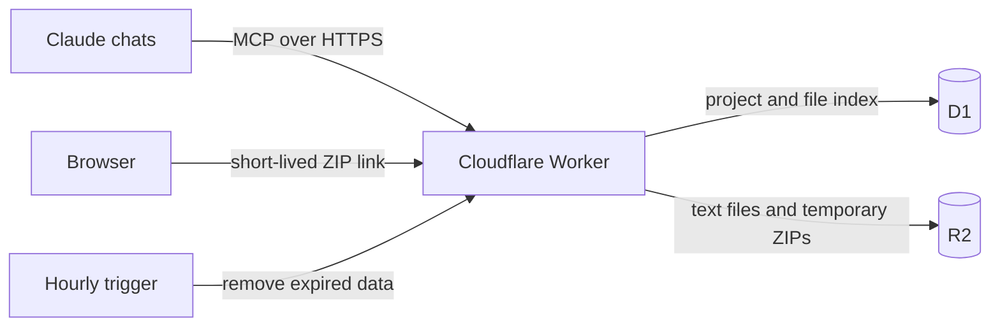

# Architecture

SavePoint is a stateless remote MCP server. Claude sends JSON-RPC requests to the Worker over HTTPS. Project contents are stored as UTF-8 objects in R2; D1 stores project metadata, file versions, and expiring download records.

## Request flow

1. The Worker accepts JSON-RPC `initialize`, `ping`, `tools/list`, and `tools/call` requests at `/mcp`.
2. If `ACCESS_KEY` is configured, MCP requests require either an `Authorization: Bearer <key>` header or the legacy `?key=<key>` query parameter. The header is preferred so credentials do not appear in URLs or logs.
3. Tool handlers validate project codes, file paths, file sizes, project limits, and file versions.
4. D1 holds project/file metadata and optimistic versions; R2 holds file bodies. File operations update project activity and automatically append to `NOTES.md` after a successful write, edit, or delete.
5. `project_download` reads the project files, creates a store-mode ZIP, and returns a short-lived link. The download route checks its token and project expiry without requiring the connector key.
6. The hourly scheduled handler removes expired projects, their R2 objects, expired ZIPs, and old rate-limit rows within a configured cleanup budget.

## Storage keys

- `p/<project-id>/files/<path>` — file contents, including `NOTES.md`
- `p/<project-id>/dl/<token>.zip` — temporary download archive

The raw project code is not used as the storage key; SavePoint derives a project ID from its normalized hash. Project codes are bearer credentials, not user accounts. Anyone with a code can access that project.

## Operational limits

Limits are set in `wrangler.toml`. Defaults are 200 files, 1 MiB per text file, 50 MiB per asset, 100 MiB per project, 12-hour idle expiry, 15-minute download links, and 120 MCP requests per IP per minute. Cloudflare account quotas are separate and should be checked before production use.

There is no per-user identity or authorization model. A configured `ACCESS_KEY` is shared by all connector users. Keep it private and rotate it if it is exposed. SavePoint stores text files only and does not execute project code.
